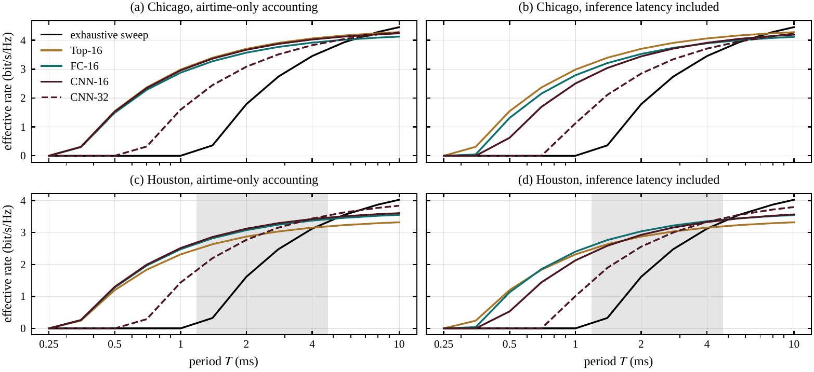

# Inference Latency as Beam-Training Overhead

### An Accuracy-Independent Budget for Learned Millimeter-Wave Beam Prediction

**Sooyoung Jang**<sup>1</sup>, **Sunmi Jun**<sup>2</sup>, **Sungwoo Choi**<sup>2</sup>, and **Eunkyung Kim**<sup>3</sup>
<sup>1</sup> Department of Computer Engineering, Hanbat National University, Daejeon 34158, Republic of Korea
<sup>2</sup> Mobile Communication Research Division, Electronics and Telecommunications Research Institute, Daejeon 34129, Republic of Korea
<sup>3</sup> Department of Artificial Intelligence Software, Hanbat National University, Daejeon 34158, Republic of Korea
Correspondence: `ekim@hanbat.ac.kr`

> **Status:** preprint, under review. This work was supported by the Institute of Information & Communications Technology Planning & Evaluation (IITP) - ITRC (Information Technology Research Center) grant funded by the Korea government (MSIT) (IITP-2025-RS-2024-00437886, 50%) and by the Institute of Information & Communications Technology Planning & Evaluation (IITP) grant funded by the Korea government (MSIT) (RS-2024-00397216, 50%); the authors declare no conflict of interest.



*Fig. S4 of the supplementary material, whose Houston panels are Fig. 4 of the paper: the same
methods, channels, users and noise realizations under airtime-only accounting (a, c) and with
inference latency included (b, d), in Chicago, where
the best of the ten methods changes at no period, and in Houston, where it changes in point
estimate at the shaded periods. The learned predictors' curves move down and to the right;
the measurement-only curves do not move.*

## Abstract

Learned beam predictors outperform the exhaustive millimeter-wave beam sweep only by finishing
sooner or selecting better beams. With accuracy unknown before training, we seek an
accuracy-independent test.
Counting inference latency as cold-start beam-training overhead, we derive an exclusion condition
from a narrow-beam predictor's completion time, a lower bound on sweep efficiency
and a maximum period. If it holds, the predictor cannot outperform the sweep at any period up to
that maximum, even with perfect selection. We apply it to eight ray-traced scenarios with
20-microsecond probes of 64 beams, at 95th-percentile latencies of single-precision
inference. It excludes two vision-model implementations finishing within the 10-millisecond
maximum: an 18-layer residual network on eight threads and a base-size vision
transformer on the graphics processor. Both are excluded above 62% sweep efficiency, also at
adverse inputs; five others exceed the maximum at that percentile and one is unresolved. In an illustrative
image-only study under sustained load, the transformer's optimized half-precision build, three
times faster, stays excluded in expected rate for recorded latencies. Latency changes the best
method in point estimate at 10 of 72 scenario-period pairs, none statistically established. A
case-study controller scheduling inference misses its pre-registered criterion. Designers can
screen predictor-processor pairs before training.

## Repository layout

```
src/
  sites/       DeepMIMO acquisition and outcome-blind scenario qualification (stage 1)
  latency/     predictor latency atlas across four hardware profiles (stage 2), and the
               matched profiling study of an optimized build (stage 4)
  budget/      accuracy-free compute budget, the T* crossover, the DP reference (stage 3)
  scheduler/   observation law, codebook, comparators, the scheduled controller, the
               analyses, and the protocol record protocol.json (stage 4)
scripts/       one runner per stage, in order
assets/        the supplementary material's Fig. S4 as PNG
```

Each stage folder holds its code and the results it writes (JSON and NPZ) side by side.
Not in the repository: the DeepMIMO scenarios (licensed by their owners, fetched by
`src/sites/acquire.py`), the built datasets and model checkpoints (their hashes are in
`src/scheduler/manifest.json`) and the large solved tables of the sweeps and of the second
re-solve, all regenerated by the stages below; and the manuscript, with the scripts that
typeset it.

## Installation

Two environments are required, because the DeepMIMO loader needs `numpy>=2` and the
rest of the pipeline is pinned to `numpy==1.26.4`.

```bash
# 1. experiment environment -- stages 2 to 4
python3 -m venv .venv && . .venv/bin/activate
pip install -r requirements.txt

# 2. DeepMIMO loader environment -- stage 1 only
python3 -m venv .venv-deepmimo && . .venv-deepmimo/bin/activate
pip install -r src/sites/requirements-pinned.txt
```

Results were produced with Python 3.13.12 and PyTorch 2.12.0+cu130 on an Intel Core
i9-14900KF and a Quadro RTX 8000, recorded in `src/latency/p_*.json`.

## Data preparation

Eight DeepMIMO v4 ray-traced city scenarios at 28 GHz. `src/sites/acquire.py`
downloads and extracts them; `qualify.py` admits a site without ever inspecting a beam
outcome. Roles are fixed before any result is computed:

| Scenario | Role | Receivers | LOS |
|---|---|---:|---:|
| `city_0_newyork_28` | training | 16303 | 4467 |
| `city_1_losangeles_28` | validation | 19911 | 4090 |
| `city_2_chicago_28` | test A | 10451 | 3609 |
| `city_3_houston_28` | test B | 19379 | 5912 |
| `city_4_phoenix_28` | held-out | 13489 | 2227 |
| `city_5_philadelphia_28` | held-out | 11302 | 3139 |
| `city_6_miami_28` | held-out | 27061 | 6739 |
| `city_7_sandiego_28` | held-out | 22681 | 8737 |

64-element ULA, 100 MHz over `K_F = 16` sub-bands, 30 dBm transmit power, 7 dB noise
figure, 20 μs per probe.

## Reproducing the results

Run the stages in order; each depends on the one before it.

```bash
./scripts/01_sites.sh           # DeepMIMO loader environment
./scripts/02_latency_atlas.sh   # timing stage -- see the warning below
./scripts/03_budget.sh
./scripts/04_experiment.sh      # includes further timing stages
```

**The timing stages need a quiet machine.** Nothing else may run on the pinned
cores. A contended run in our own testing inflated the measured predictor latency
`τ₁` from 13.8 μs to 21.1 μs, which is larger than several of the effects the paper
reports. Each stage prints the load average and a re-check drift, and labels itself
`quiet` or `CONTENDED`; discard a `CONTENDED` run.

`scripts/04_experiment.sh` starts by verifying the protocol record
(`src/scheduler/protocol.py`): the frozen protocol's hash, the hashes of the inputs it
depends on, and those of the stored results it lists. The long runs of stage 4 are skipped
unless their flag is set (`RETIME`, `RERANK`, `EXACT`, `SCREEN`, `CALIB`, `NRCFG`,
`LEVELS`, `TRACE`, `MATCHED`; see the comments in the script). Every result the paper reports is
stored in the repository.

## Protocol record and result files

The measurement model and the six-layer hierarchical codebook are frozen in
`src/scheduler/obs.py`. `src/scheduler/protocol.json` is the protocol record:

- the protocol as frozen on 2026-09-15, before any dataset was built, any model trained or any
  number seen (its fields hash to `self_sha256`);
- its three amendments, A1–A3;
- the changes made after results existed, each dated, with its reason;
- the interpretation rules R1–R23, which state what each result permits the paper to claim,
  each with the date it was set and whether it was set after the results it reads;
- the later analyses, each declared before it ran, with its scripts, its rules and the
  hashes of the stored files it wrote.

`python3 src/scheduler/protocol.py` checks the frozen hash, the inputs the protocol depends on
and those stored files. Stored outputs also record the hashes of the scripts that wrote them
(`scripts_sha256` in the record); the scripts here compute the same results and differ from
those only in comments, help texts and record keeping. The stored result files are as
those scripts wrote them, less record-keeping fields; the hashes that some of them record of
others refer to the files as released. The gate outcome computed with the predictor before
amendment A3 is kept in `src/scheduler/results_pre_A3.json` and `report_pre_A3.json`.

Result files in `src/scheduler/` are named after the run that wrote them:

| Name | Contents |
|---|---|
| `validation`, `results`, `heldout` | the validation scenario, the two test scenarios and the four held-out scenarios, ten seeds |
| `report` | the variant selection and the comparisons computed from those runs (`analyze.py`) |
| `*_3seed` | the pre-registered three-seed analysis (seeds 17, 29, 43) |
| no suffix, `_rr`, `_rx` | the controller results in three versions: as recorded, without the time of choosing the next codeword after an inference call (a masked argmax, 1.06 μs); re-solved with that time counted on every probe of a sequence that invokes the predictor (`rerank.py`); and re-solved with it counted only after the first inference call, whose probe count enters the controller's state (`exact.py`). The paper reports the third |
| `sweep*_rho*`, `sweep*_tp*`, `sweep*_oq*` | the sensitivity runs: hardware ratio ρ, probe airtime, predictor quality q |
| `lat_*.json`, `../latency/p_*.json`, `o_*.json`, `o2_*.json` | the timings: the controller's charges and the latency atlas's profiles and compiled runtimes |
| `matched` | the matched profiling study read by rule R22 (`matched.py`): an image-only ViT-B/16 on the GPU, FP32 against one FP16 build, in expected effective rate; its pilot and three sessions, every call kept, are in `../latency/profile_matched/` |
| `matched_post` | rule R23, set after the matched study's outputs (`matched_post.py`): its readings restated as exact for each session's recorded calls, with calculations on those records that R22 did not name or named only pooled, each with the other inputs held fixed: per-session horizons, efficiencies and airtimes, the factor by which every completion time must be divided to remove the exclusion, at adverse and measured inputs, and the factor at which R22's own procedure stops reading an exclusion |
| `manifest.json` | hashes of the datasets and model checkpoints, which are regenerated, not tracked |

## Citation

```bibtex
@unpublished{jang2026latency,
  title  = {Inference Latency as Beam-Training Overhead: An Accuracy-Independent
            Budget for Learned Millimeter-Wave Beam Prediction},
  author = {Jang, Sooyoung and Jun, Sunmi and Choi, Sungwoo and Kim, Eunkyung},
  year   = {2026},
  note   = {Manuscript under review}
}
```

## Acknowledgement

The ray-traced channels come from the **DeepMIMO** dataset, whose license requires
both of the citations below. They are also recorded in `src/sites/site-manifest.json`.

- A. Alkhateeb, "DeepMIMO: A generic deep learning dataset for millimeter wave and
  massive MIMO applications," in *Proc. Information Theory and Applications Workshop
  (ITA)*, San Diego, CA, Feb. 2019.
- Remcom, *Wireless InSite* — the ray tracer behind these scenarios.

None of the eight scenario archives carries a further per-scenario citation
requirement. The scenario data itself is not redistributed here.

The comparator we reproduce is the adaptive hierarchical beam-training method of
Zhang et al., *Adaptive beam alignment method for millimeter-wave massive MIMO
communication systems*, Physical Communication 41 (2020) 101101.

## License

Released under the MIT License — see [`LICENSE`](LICENSE).

The DeepMIMO scenario data is not covered by it and is not redistributed here; it
carries its own terms, summarised under Acknowledgement.
