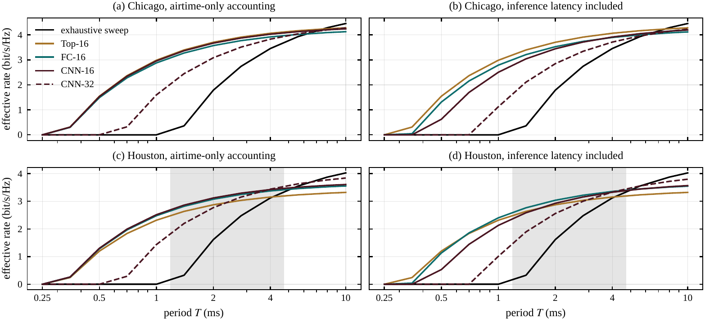

# Inference-Latency Budgets for Learned Beam Prediction Under 5G NR Timing

**Sooyoung Jang**<sup>1</sup>, **Sunmi Jun**<sup>2</sup>, **Sungwoo Choi**<sup>2</sup>, and **Eunkyung Kim**<sup>3</sup>
<sup>1</sup> Department of Computer Engineering, Hanbat National University, Daejeon 34158, Republic of Korea
<sup>2</sup> Mobile Communication Research Division, Electronics and Telecommunications Research Institute, Daejeon 34129, Republic of Korea
<sup>3</sup> Department of Artificial Intelligence Software, Hanbat National University, Daejeon 34158, Republic of Korea
Correspondence: `ekim@hanbat.ac.kr`

> This repository holds the code and stored outputs behind the letter; every number the letter
> prints is computed by `src/scheduler/letter.py` (`letter.json`). This work was supported by the Institute of Information & Communications Technology Planning & Evaluation (IITP) - ITRC (Information Technology Research Center) grant funded by the Korea government (MSIT) (IITP-2025-RS-2024-00437886, 50%) and by the Institute of Information & Communications Technology Planning & Evaluation (IITP) grant funded by the Korea government (MSIT) (RS-2024-00397216, 50%); the authors declare no conflict of interest.



*Effective rate against the re-acquisition period: the same methods, channels, users and noise
realizations under airtime-only accounting (a, c) and with
inference latency included (b, d), in Chicago, where
the best of the ten methods changes at no period, and in Houston, where it changes in point
estimate at the shaded periods. The learned predictors' curves move down and to the right;
the measurement-only curves do not move.*

## Abstract

On a cold-start link, learned beam predictors outperform the exhaustive millimeter-wave sweep only
by finishing sooner or selecting better beams. With inference latency counted as overhead, even a
perfect predictor cannot outperform the sweep up to a maximum period if its latency exceeds a
budget, the time it saves before inference, by at least a slack set by the sweep's efficiency.
Against time-division New Radio reference-signal sweeps, a four-probe predictor's budget is
0.27–5.25 milliseconds. At conservative efficiency bounds on ray-traced
channels, two single-precision vision-model implementations on a desktop are excluded against most
references, and their reduced-precision builds against no sweep.

## Repository layout

```
src/
  sites/       DeepMIMO acquisition and outcome-blind scenario qualification (stage 1)
  latency/     predictor latency atlas across four hardware profiles (stage 2), and the
               matched profiling study of an optimized build, its cadence study and the
               decision audit's timing campaign (stage 4)
  budget/      accuracy-free compute budget, the T* crossover, the DP reference (stage 3)
  scheduler/   observation law, codebook, comparators, the scheduled controller, the
               analyses, and the protocol record protocol.json (stage 4)
scripts/       one runner per stage, in order
assets/        the effective-rate figure above, as PNG
```

Each stage folder holds its code and the results it writes (JSON and NPZ) side by side.
Not in the repository: the DeepMIMO scenarios (licensed by their owners, fetched by
`src/sites/acquire.py`), the built datasets and model checkpoints (their hashes are in
`src/scheduler/manifest.json`) and the large solved tables of the sweeps and of the second
re-solve, all regenerated by the stages below; and the manuscripts, the letter and an
unpublished long version, with the scripts that typeset them.

## Installation

Two environments are used: the DeepMIMO loader has its own pins
(`src/sites/requirements-pinned.txt`), and the rest of the pipeline uses `requirements.txt`, the
versions of the environment `src/scheduler/manifest.json` records.

```bash
# 1. experiment environment -- stages 2 to 4
python3 -m venv .venv && . .venv/bin/activate
pip install -r requirements.txt

# 2. DeepMIMO loader environment -- stage 1 only
python3 -m venv .venv-deepmimo && . .venv-deepmimo/bin/activate
pip install -r src/sites/requirements-pinned.txt
```

Results were produced with Python 3.13.12 and PyTorch 2.12.0+cu130 on an Intel Core
i9-14900KF and a Quadro RTX 8000, recorded in `src/latency/p_*.json`.

## Data preparation

Eight DeepMIMO v4 ray-traced city scenarios at 28 GHz. `src/sites/acquire.py`
downloads and extracts them; `qualify.py` admits a site without ever inspecting a beam
outcome. Roles are fixed before any result is computed:

| Scenario | Role | Receivers | LOS |
|---|---|---:|---:|
| `city_0_newyork_28` | training | 16303 | 4467 |
| `city_1_losangeles_28` | validation | 19911 | 4090 |
| `city_2_chicago_28` | test A | 10451 | 3609 |
| `city_3_houston_28` | test B | 19379 | 5912 |
| `city_4_phoenix_28` | held-out | 13489 | 2227 |
| `city_5_philadelphia_28` | held-out | 11302 | 3139 |
| `city_6_miami_28` | held-out | 27061 | 6739 |
| `city_7_sandiego_28` | held-out | 22681 | 8737 |

64-element ULA, 100 MHz over `K_F = 16` sub-bands, 30 dBm transmit power, 7 dB noise
figure, 20 μs per probe.

## Reproducing the results

Run the stages in order; each depends on the one before it.

```bash
./scripts/01_sites.sh           # DeepMIMO loader environment
./scripts/02_latency_atlas.sh   # timing stage -- see the warning below
./scripts/03_budget.sh
./scripts/04_experiment.sh      # includes further timing stages
```

**The timing stages need a quiet machine.** Nothing else may run on the pinned
cores. A contended run in our own testing inflated the measured predictor latency
`τ₁` from 13.8 μs to 21.1 μs, which is larger than several of the effects the paper
reports. Each stage prints the load average and a re-check drift, and labels itself
`quiet` or `CONTENDED`; discard a `CONTENDED` run.

`scripts/04_experiment.sh` starts by verifying the protocol record
(`src/scheduler/protocol.py`): the frozen protocol's hash, the hashes of the inputs it
depends on, and those of the stored results it lists. The long runs of stage 4 are skipped
unless their flag is set (`RETIME`, `RERANK`, `EXACT`, `SCREEN`, `CALIB`, `NRCFG`,
`LEVELS`, `TRACE`, `MATCHED`, `CADENCE`, `AUDIT`, `DEPLOY`; see the comments in the script). Every number the
letter prints is computed by `src/scheduler/letter.py` from files stored here (`letter.json`).
The rule texts and the per-rule rows below were written for an unpublished long version of the
paper: their section, proposition and table numbers are that version's, and numbers it states
beyond the letter's are computed from the stored files by the scripts that typeset it, which are
not released.

## Protocol record and result files

The measurement model and the six-layer hierarchical codebook are frozen in
`src/scheduler/obs.py`. `src/scheduler/protocol.json` is the protocol record:

- the protocol as frozen on 2026-09-15, before any dataset was built, any model trained or any
  number seen (its fields hash to `self_sha256`);
- its three amendments, A1–A3;
- the changes made after results existed, each dated, with its reason;
- the interpretation rules R1–R50, which state what each result permits the paper to claim,
  each with the date it was set and whether it was set after the results it reads;
- the later analyses, each declared before it ran, with its scripts, its rules and the
  hashes of the stored files it wrote.

`python3 src/scheduler/protocol.py` checks the frozen hash, the inputs the protocol depends on
and those stored files. Stored outputs also record the hashes of the scripts that wrote them
(`scripts_sha256` in the record); the scripts here compute the same results and differ from
those only in comments, help texts and record keeping. The stored result files are as
those scripts wrote them, less record-keeping fields; the hashes that some of them record of
others refer to the files as released. The gate outcome computed with the predictor before
amendment A3 is kept in `src/scheduler/results_pre_A3.json` and `report_pre_A3.json`.

Result files in `src/scheduler/` are named after the run that wrote them:

| Name | Contents |
|---|---|
| `validation`, `results`, `heldout` | the validation scenario, the two test scenarios and the four held-out scenarios, ten seeds |
| `report` | the variant selection and the comparisons computed from those runs (`analyze.py`) |
| `*_3seed` | the prespecified three-seed analysis (seeds 17, 29, 43) |
| no suffix, `_rr`, `_rx` | the controller results in three versions: as recorded, without the time of choosing the next codeword after an inference call (a masked argmax, 1.06 μs); re-solved with that time counted on every probe of a sequence that invokes the predictor (`rerank.py`); and re-solved with it counted only after the first inference call, whose probe count enters the controller's state (`exact.py`). The paper reports the third |
| `sweep*_rho*`, `sweep*_tp*`, `sweep*_oq*` | the sensitivity runs: hardware ratio ρ, probe airtime, predictor quality q |
| `lat_*.json`, `../latency/p_*.json`, `o_*.json`, `o2_*.json` | the timings: the controller's charges and the latency atlas's profiles and compiled runtimes |
| `matched` | the matched profiling study read by rule R22 (`matched.py`): an image-only ViT-B/16 on the GPU, FP32 against one FP16 build, in expected effective rate; its pilot and three sessions, every call kept, are in `../latency/profile_matched/` |
| `matched_post` | rule R23, set after the matched study's outputs (`matched_post.py`): its readings restated as exact for each session's recorded calls, with calculations on those records that R22 did not name or named only pooled, each with the other inputs held fixed: per-session horizons, efficiencies and airtimes, the factor by which every completion time must be divided to remove the exclusion, at adverse and measured inputs, and the factor at which R22's own procedure stops reading an exclusion |
| `cadence` | the cadence study read by rule R24 (`cadence.py`): the matched study's two builds at three invocation spacings (back to back, and starts at least 10 and 50 ms apart), three sessions each in an order frozen before the first ran, every call kept, read in expected effective rate for each session's recorded calls; the sessions are in `../latency/profile_cadence/` |
| `calib_audit` | the calibration audit of rule R25 (`calib_audit.py`): the sweep-efficiency bound's procedure applied to 200 samples of 4, 8 and 12 spatial blocks from each evaluation scenario, its coverage of the population's efficiency and how often it keeps four exclusions |
| `audit_*` | the decision audit of rule R26: three image-only GPU builds (ResNet-18 in FP32 compiled by TorchScript, and the matched study's two ViT-B/16 builds) timed in 15 randomized rounds at a 10 ms spacing (`../latency/profile_audit/`); the per-probe sweep with a 10, 20 or 30 μs pilot in Houston and Phoenix (`audit_pop`); the screen's efficiency bounds from 200 calibrations of 4, 8 and 12 spatial blocks (`audit_bounds`) and its decisions from rounds 1–5, recorded before rounds 6–15 ran (`audit_decisions`); and an independent auditor that computes every rate from the ray-traced paths and evaluates the decisions in the same finite populations and on the later rounds (`audit_direct`, with its population efficiencies in `audit_rates.json`); its pilot on the validation scenario set the numerical tolerance (`audit_pilot`, `audit_direct_pilot`) |
| `fallback`, `strata_eta` | rules R27 and R28, set post hoc and read from stored outputs alone: the screen for a procedure that sends data on the best probed beam while the predictor infers, against the fixed methods that need no training, at each implementation's 95th percentile, its lower bound and, for the three decisive implementations, its fastest recorded call (`fallback.py`); and the sweep's efficiency within each prespecified SNR stratum of the seven non-training scenarios, against every exclusion's threshold (`strata_eta.py`) |
| `nrtdd.py`, `ssbref` | rules R30 and R31, set post hoc: the CSI-RS procedure's report times and budgets under the two time-division reference patterns of TS 38.101-2 at 120 kHz, DDDSU and 7DS8U, every procedure scheduled as early as the pattern allows (`nrtdd.py`, a module the paper imports; on paired spectrum it reproduces `nrtime.py`); and an SS-block-guided CSI-RS refinement, the strongest of 8 or 16 wide codewords refined by one set of its 8 or 4 nearest narrow beams, with its efficiency and simultaneous bounds on `csirs.py`'s draws (`ssbref.py`) |
| `nrue.py`, `ssbsens` | rules R32 to R34, set post hoc: a candidate that infers at the user equipment, whose inference before its earliest report costs nothing, and its budgets on paired spectrum and under both patterns; the period up to which the SS-block-guided refinement delivers more than the sweep at the measured efficiencies, whatever the delay common to both (`nrue.py`, a module the paper imports, on stored outputs); and the refinement with its SS blocks measured on 198, 66 or 33 samples (`ssbsens.py`) |
| `nrmu.py` | rule R35, set post hoc: the paired CSI-RS budgets with both carriers at 60 kHz (TS 38.214 Table 5.4-2 at mu = 2; gate M reproduces `nrtime.py` at 120 kHz), and the per-probe sweep over every transmit-receive pair with 2, 4 or 8 analog receive beams (a module the paper imports) |
| `nrtddmu.py` | rule R36, set post hoc: rule R30's time-division procedure with both carriers at 60 kHz, on TS 38.101-2's 60 kHz test patterns (DDDSU every 1.25 ms, DDDSUUUU every 2 ms); gate T reproduces `nrtdd.py` at 120 kHz, gate P `nrmu.py` on paired spectrum (a module the paper imports) |
| `covpop`, `covpop_direct` | rule R37, set post hoc: the covered population (the rule's operating population), the users whose genie-aided rate reaches CQI 1 of TS 38.214's CQI Table 2 (0.1523 bit/s/Hz; as a sensitivity, an effective SNR of at least −6 dB). Every efficiency bound the paper reports (`csirs`, `csirs_cfg`, `refbounds`, `ssbref`) recomputed on it with each pipeline's own selections, streams, levels and windows, and the decision audit's screen on it (`covpop.py`; on all users it reproduces the stored files exactly); the auditor's side, with the auditor's own rates and code (`covpop_direct.py`) |
| `deploy` | the deployment-runtime study read by rule R38, declared before any of its timings (`deploy.py`): compiled reduced-precision builds of the two vision models the screen excludes, with the installed PyTorch (ResNet-18 on the GPU in FP16, eager, in one CUDA graph and compiled in max-autotune mode; ViT-B/16 in that graph and so compiled; ResNet-18 on eight P-core threads compiled in FP32 and quantized to INT8), each group's fastest chosen by a pilot and timed against its FP32 build in three sessions; the pilot and sessions are in `../latency/profile_deploy/` |
| `nrue19.py`, `nrconf.py` | rule R39, set post hoc: the UE-side candidate under Release 19's predicted-beam report timing, (Z<sub>3</sub> + d, Z′<sub>3</sub> + d′) with d and d′ declared by the UE (TS 38.214 V19.5.0 5.4, TS 38.306 V19.4.0 4.2.7.2); and the CSI-RS budgets when the network measures its predicted beams again before data (TR 38.843 6.3.1), at 120 and 60 kHz, paired and under the test patterns (modules the paper imports) |
| `robust` | rule R40, set post hoc (`robust.py`): the sweep's efficiency and per-probe slack under per-beam report errors of 0–3 dB in 1 dB steps; the overstatement of the genie-aided rate when bounded from band-averaged powers (Jensen's inequality), also from 1 dB report ranges; and the efficiency with every rate capped at CQI Table 2's 7.4063 bit/s/Hz |
| `boundary` | rule R42, set post hoc (`boundary.py`): the decision audit's screen at its decision boundary, from the stored calibration draws on all users and on the covered population: the largest opportunity any calibration excludes, the share excluding an opportunity just above zero, and the smallest loss excluded in 95% of calibrations; gates B1–B2 reproduce the audit's coverage and overshoot |
| `covtrain` | rule R43, set post hoc (`covtrain.py`): the stored FC and CNN predictors and Top-K on the validation scenario's covered users, and the same architectures retrained with `train_base.py` on the training scenario's covered users (checkpoints regenerated, not tracked); gate T1 reproduces `predictor_profile.json` on all users |
| `uepairs` | rule R44, set post hoc (`uepairs.py`): transmit-receive pair sweeps with 2- and 4-element user arrays built from the stored paths' arrival angles, their efficiencies and simultaneous bounds on all and covered users, and per-user efficiencies (`uepairs.npz`); with one element it reproduces the per-probe sweep's efficiency and bounds exactly |
| `widepow` | rule R45, set post hoc (`widepow.py`): Hier-6 and the SS-block-guided refinement with every wide codeword held to a narrow beam's power per element, on the unscaled readings' draws; unscaled, it reproduces both |
| `rsrpacc` | rule R46, set post hoc (`rsrpacc.py`): rule R40's report errors at the per-beam sigma that meets TS 38.133's FR2 relative L1-RSRP accuracy (6.5 and 9.5 dB in 90% of reports); at 3 dB it reproduces `robust.json`. Release 19's declarable relaxations (TS 38.331 V19.4.0, 6.3.3) are compared with rule R39's in the paper's generator |
| `multiuser` | rule R48, set post hoc (`multiuser.py`): Proposition 4's shared panel, with users acquiring together and serialized inference, simulated on the decision audit's two cities' covered users (fluid round robin; 1–16 cold and 0, 1 or 8 warm users; 200 draws): whether a perfect predictor's panel, and its cold users alone, deliver at most the sweep's at every period up to 10 ms, at the paper's implementations' latencies; gates M1–M3 reproduce one link's data and verdict, equal data for equal methods and the panel's idle time. The rule's "Proposition 4" is the long version's Proposition 3 (`protocol.json`, change of 2026-11-10); rule R47's NR period anchors and horizons are recomputed for the letter by `letter.py` |
| `covcurve` | rule R49, set post hoc (`covcurve.py`): the decision audit's efficiency bound on calibrations of 4, 8, 12, 16 and all but one of a city's blocks in Houston and Phoenix, on all and covered users, and its coverage of the auditor's population efficiency; gates V1–V2 reproduce the audit's stored coverage and ten stored draws per cell bit for bit |
| `timespread` | rule R50, set post hoc (`timespread.py`): every stored timing session's 95th percentile per implementation (stored timings, repeated runs, the matched, cadence, audit and deployment studies), the spread within and across studies, the lowest session and the fastest call; the paper re-reads each verdict at the lowest session; gates S1–S2 check that every charge the paper uses was read and that the audit sessions match their stored counts and minima |
| `margins_post` | the margins as rules R16, R19 and R21 read them (`margins_post.py`, recorded in `protocol.json` as a change of 2026-10-31): every threshold, margin and delay limit the paper states under the CSI-RS procedure, with `nrtime.py`'s report times, at the runtimes of `reconcile.json`, and each exclusion's excess under channel aging at those runtimes. It supersedes the `nr_*` fields of `margins.json` and `reconcile.json`, which leave out the report times, and the excess in `aging_bound.json`, read from the stored timings; those files stay as written |
| `letter` | the letter's numbers (`letter.py`, recorded in `protocol.json` as a change of 2026-11-10): for a 4-probe predictor against each reference, the budget over every declarable timing and first-trigger slot, the slack at the measured efficiency and the bounds, the efficiency each implementation's exclusion needs at adverse inputs and at the fastest stored call, the statuses (excluded, unresolved, not excluded), the horizons and the NR periods they cover, and the SS-guided refinement under the two time-division patterns, which the long version states but does not tabulate; gates G1–G8 pin the timing modules and reproduce the long version's stated budgets, margins, unresolved entries and fastest-call losses |
| `manifest.json` | hashes of the datasets and model checkpoints, which are regenerated, not tracked |

## Citation

```bibtex
@unpublished{jang2026budgets,
  title  = {Inference-Latency Budgets for Learned Beam Prediction Under 5G {NR} Timing},
  author = {Jang, Sooyoung and Jun, Sunmi and Choi, Sungwoo and Kim, Eunkyung},
  year   = {2026}
}
```

## Acknowledgement

The ray-traced channels come from the **DeepMIMO** dataset, whose license requires
both of the citations below. They are also recorded in `src/sites/site-manifest.json`.

- A. Alkhateeb, "DeepMIMO: A generic deep learning dataset for millimeter wave and
  massive MIMO applications," in *Proc. Information Theory and Applications Workshop
  (ITA)*, San Diego, CA, Feb. 2019.
- Remcom, *Wireless InSite* — the ray tracer behind these scenarios.

None of the eight scenario archives carries a further per-scenario citation
requirement. The scenario data itself is not redistributed here.

The comparator we reproduce is the adaptive hierarchical beam-training method of
Zhang et al., *Adaptive beam alignment method for millimeter-wave massive MIMO
communication systems*, Physical Communication 41 (2020) 101101.

## License

Released under the MIT License — see [`LICENSE`](LICENSE).

The DeepMIMO scenario data is not covered by it and is not redistributed here; it
carries its own terms, summarised under Acknowledgement.
